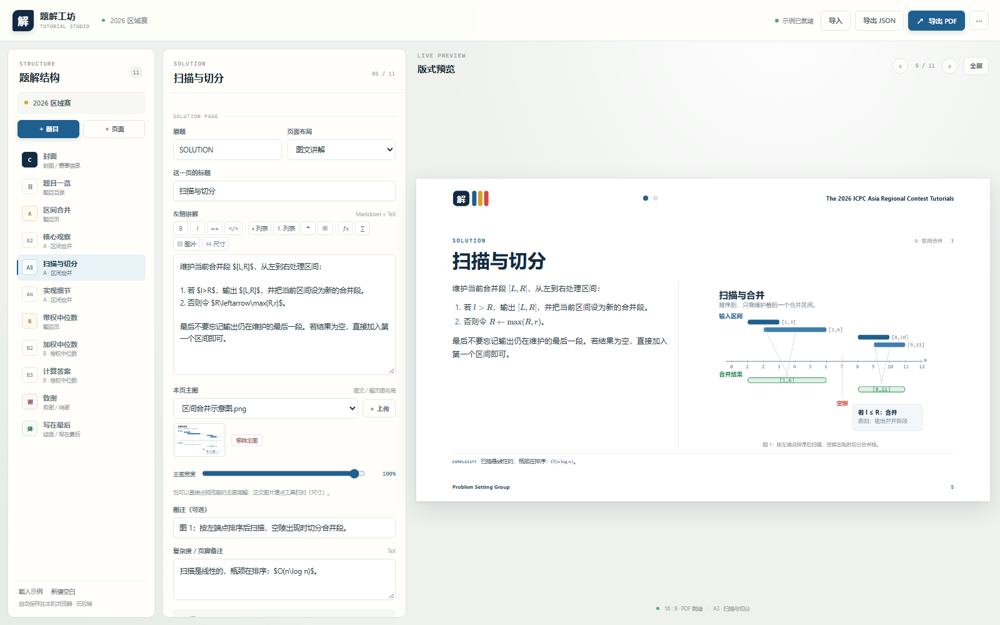
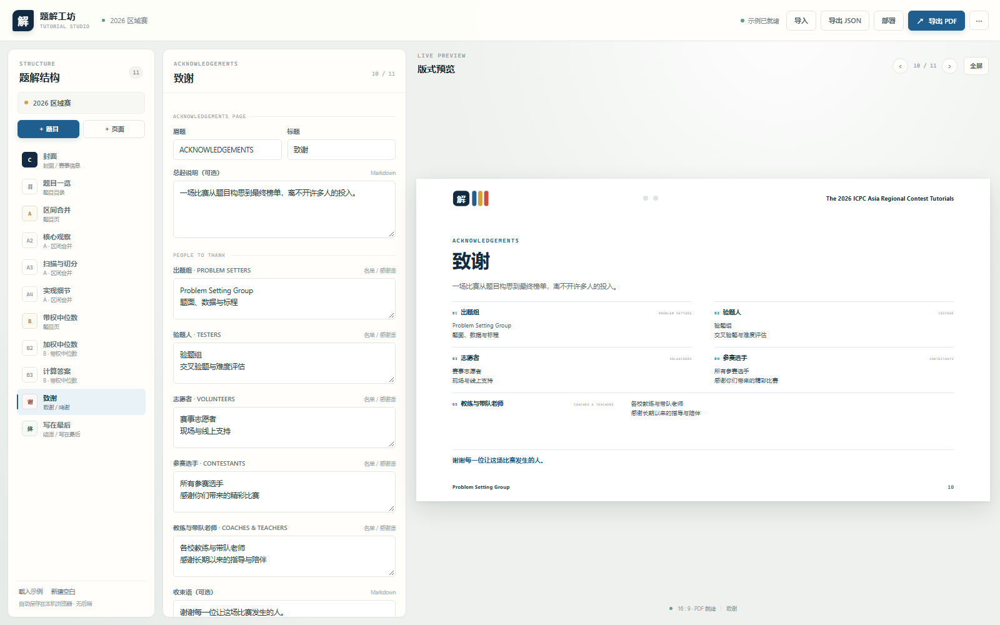
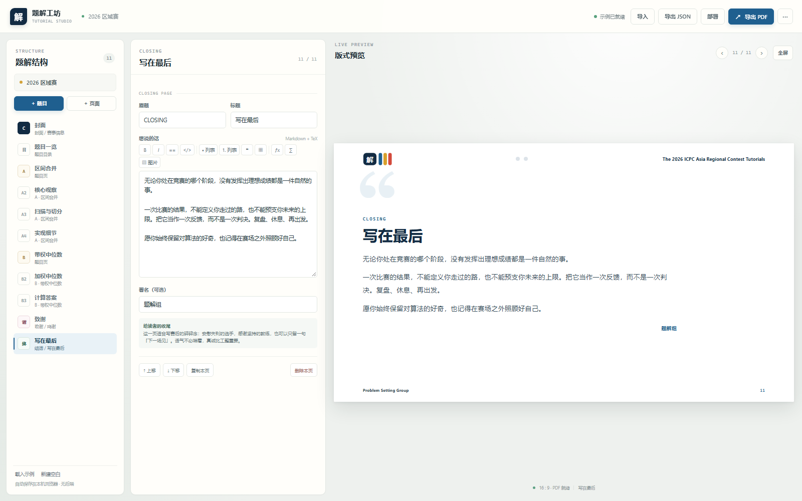

# 题解工坊 · Tutorial Studio

一个不用安装、不用后端、可以直接部署到 GitHub Pages 的竞赛题解排版工具。目标是做出类似区域赛官方题解那种干净的 16:9 横向讲义：白色页面、深蓝标题、题号与进度点、左右双栏、比赛数据侧栏，以及可以放进正文的 TeX 公式和示意图。



示例成稿（11 页，含致谢与结语）：[examples/示例题解.pdf](examples/示例题解.pdf)

## 功能

- **多题题解**：一场比赛可以放多道题，每道题自动生成题目页，下面挂任意多页解法；页眉进度点会标出当前题。
- **16:9 版式**：固定 960 × 540 pt / 13.333 × 7.5 in，适合 PDF、投影和网页预览。
- **TeX 公式**：本地 KaTeX 渲染，支持 `$...$`、`$$...$$`、`\(...\)`、`\[...\]`，以及 `aligned`、`cases`、`matrix` 等环境；带公式面板、符号面板和实时预览。
- **图片**：支持上传、拖拽、粘贴截图；图片会压缩后嵌入工程 JSON。正文可以插多张图，图文页可以放主图并配图注。
- **Markdown**：标题、粗斜体、`==高亮==`、列表、引用、表格、代码块、链接。
- **独立收尾页**：一页结构化「致谢」，分别填写出题组、验题人、志愿者、参赛选手、教练与带队老师；再一页自由撰写的「结语」，适合写赛后的碎碎念。
- **导出 PDF**：使用浏览器打印生成矢量文字 PDF；每页固定 16:9，不经过截图。
- **工程文件**：自动保存到浏览器 IndexedDB（不可用时退回 localStorage）；支持导入/导出 JSON，方便备份和交换。
- **GitHub Pages**：纯静态站点，自带 Actions 工作流，推到 `main` 即自动部署，其他人打开网址就能用。

## 直接使用

### 方式一：双击打开

直接双击 `index.html`。建议使用新版 Chrome / Edge。所有依赖（KaTeX、Marked、DOMPurify）都在 `vendor/` 里，不需要联网。

> 用 `file://` 打开时，部分浏览器会限制 IndexedDB。工具会自动退回 localStorage；如果仍然无法保存，请用方式二启动一个本地静态服务器。

### 方式二：本地静态服务器

```powershell
cd 题解工具
python -m http.server 8080
```

然后打开 <http://localhost:8080/>。

第一次进入会载入一份示例题解，可以直接改，也可以点左下角「新建空白」从零开始。

## 怎么写

### 1. 结构

- 「＋ 题目」：新增一道题，同时创建题目页和第一页解法。
- 「＋ 页面」：
  - **在题目下添加解法页**：继续拆推导。
  - **添加自定义页**：写约定、目录说明等。
  - **添加题目目录页**：自动列出所有题目的名称、难度和题解页数。
  - **添加致谢页**：独立的收尾页，分别填写出题组、验题人、志愿者、参赛选手、教练与带队老师。
  - **添加结语页**：独立成页的「写在最后」，适合写赛后的碎碎念。
- 每页底部可以上移、下移、复制、删除。封面固定在第一页；致谢和结语默认追加到全册末尾。

### 2. 题目页

题目页包含：

- 题号、题目名称、题面摘要、Constraints；
- Idea by / Prepared by；
- Teams Attempted / Teams Solved / First Blood / Expected Difficulty / Judge Solution；
- 标签。

右侧比赛数据留空就不会显示。**不要把非公开比赛的数据随工程上传到公开仓库。**

### 3. 解法页布局

| 布局 | 用途 |
| --- | --- |
| 双栏推导 | 左栏核心观察，右栏证明 / 补充；中间自动分隔线 |
| 通栏内容 | 完整证明、长代码、大表格 |
| 图文讲解 | 左文右图，适合算法示意图 |
| 整页图片 | 一张复杂图占满正文 |

### 4. TeX

行内：

```markdown
排序后只需比较最后一个区间 $[L,R]$。
```

独占一行：

```markdown
$$
F(x)=\sum_{i=1}^{n} w_i\,|x_i-x|.
$$
```

点击工具栏的 `ƒx` 或 `∑` 会打开公式面板；`Ctrl/⌘ + M` 也可以。面板里有常用符号、分数、根号、求和、积分、矩阵、分段函数等模板。KaTeX 不支持 `\usepackage`、TikZ 等完整 LaTeX 文档命令；复杂图请画成图片插入。

### 5. 图片

- 在正文工具栏点「图片」，上传后点「插入」；
- 或直接把截图粘贴到正文输入框；
- 或把图片文件拖进编辑区；
- 图文页 / 整页图布局可以在「本页主图」里选择图片。

图片会按最长边约 1800 px 压缩，并以 data URL 存在工程 JSON 里。工程会比较大，这是为了让 JSON 可以单文件备份和交换。

### 6. 导出 PDF

点击右上角「导出 PDF」：

1. 目标打印机选「另存为 PDF」；
2. 纸张保持横向 16:9，边距选「无」；
3. 关闭「页眉和页脚」，开启「背景图形」；
4. 导出后翻到最后一页，确认没有内容被裁切。

预览右上角出现「内容可能溢出」时，说明当前页文字或图片超过了 16:9 画布，建议精简文字或拆到下一页。

### 7. 致谢与结语

这两页是独立页面，不挂在某道题下面：

- **致谢页**：固定五个感谢对象（出题组、验题人、志愿者、参赛选手、教练与带队老师），每个都可以填名单或多行感谢语。适合放在全部题目之后。
- **结语页**：一个标题、一段自由撰写的 Markdown 正文和一个署名。默认内容是一段关于「没发挥好也很正常，不要灰心」的话，可以整段替换。





示例工程最后就附了这两页，导出的 PDF 里可以直接看版式。

## 部署到 GitHub Pages（给别人用）

这个项目没有构建步骤，仓库根目录就是站点。

### 1. 新建仓库并推送

在 GitHub 新建一个空仓库，然后在本目录执行：

```powershell
git init
git add .
git commit -m "deploy tutorial studio"
git branch -M main
git remote add origin https://github.com/<your-name>/<repo>.git
git push -u origin main
```

也可以直接运行：

```powershell
.\deploy.ps1 -RepoUrl https://github.com/<your-name>/<repo>.git
```

### 2. 开启 Pages

进入仓库 **Settings → Pages → Build and deployment**，把 **Source** 设为 **GitHub Actions**。

仓库里的 [.github/workflows/pages.yml](.github/workflows/pages.yml) 会在每次推送到 `main` 时：

1. 把静态文件复制到 `_site`；
2. 上传 Pages artifact；
3. 部署。

### 3. 访问

等待 Actions 变绿后，地址是：

```text
https://<your-name>.github.io/<repo>/
```

把这个网址发给别人，对方就能直接使用编辑器。

### 关于「分享题解」

GitHub Pages 托管的是**编辑器**，不是某个人的草稿。每个人的草稿只保存在自己的浏览器里：

- 分享**成稿**：导出 PDF；
- 分享**可继续编辑的工程**：导出 JSON，对方用「导入」打开；
- 不要把带私有数据的 JSON 提交到公开仓库。

## 数据与隐私

- 没有后端，没有账号，没有自动上传。
- 草稿保存在当前浏览器的 IndexedDB；不可用时退回 localStorage。
- 题面、标程、图片、比赛数据都不会离开本机，除非你主动导出或部署。
- `_reference/` 里的参考 PDF 仅用于本地对照，已在 `.gitignore` 中排除，不会进入仓库或 Pages。
- 导入 JSON 时会用 DOMPurify 清洗 Markdown 中的 HTML，KaTeX 也关闭了 `trust`。

## 目录结构

```text
index.html                 应用入口
styles.css                 界面 + 幻灯片 + 打印样式
js/
  app.js                   编辑器、弹窗、交互、导入导出
  model.js                 工程数据模型、规范化、IndexedDB 存储
  markdown.js              Markdown + TeX + 图片解析
  render.js                16:9 页面渲染
  util.js                  工具函数
  demo.js                  内置示例内容
  demo-assets.js           示例图片（由脚本生成，内嵌 base64）
vendor/
  katex/                   KaTeX 0.16.22（含字体）
  marked.umd.js            Marked 12.0.2
  purify.min.js            DOMPurify 3.2.4
assets/                    示例图片源文件
tools/                     生成示例图片
docs/                      README 截图
examples/                  示例 PDF
_reference/                本地参考 PDF（不提交）
```

## 开发

没有打包器，改完文件刷新即可。所有脚本都使用普通 `<script>`，方便 `file://` 直接打开。

重新生成示例插图：

```powershell
python tools/make-demo-assets.py
```

当前第三方版本：

- KaTeX 0.16.22
- Marked 12.0.2
- DOMPurify 3.2.4

许可证文本见 [`THIRD_PARTY_NOTICES.md`](THIRD_PARTY_NOTICES.md) 和 `vendor/licenses/`。

## License

MIT。示例题解与插图为本项目原创，可自由修改使用。参考 PDF 不属于本仓库。

